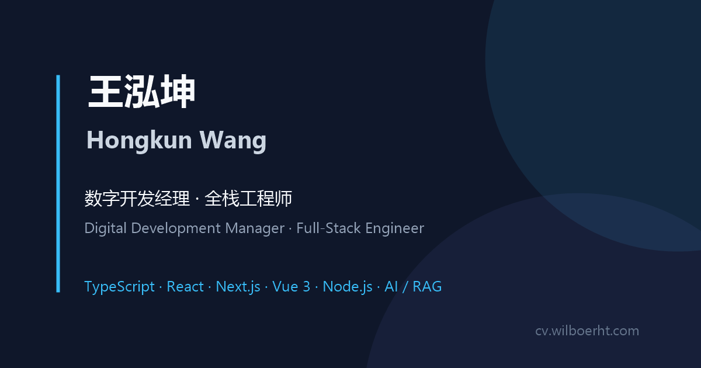

# Web CV

A fast, multilingual, print-ready personal CV built with [Astro](https://astro.build).

[Live CV](https://cv.wilboerht.com) · [GitHub](https://github.com/Wilboerht/Web-CV)



## Overview

This repository contains the source code for my personal curriculum vitae. The
code is open-sourced as a reference for building a static, accessible,
print-optimized CV with Astro.

The CV is available in 7 languages: Simplified Chinese, Traditional Chinese
(Taiwan), Traditional Chinese (Hong Kong), English, German, Korean, and
Japanese.

## Features

- **7 locales** with per-page `hreflang`, localized UI labels, and language
  switching.
- **Print / PDF first**: A4 `@page` rules, print-only footer, deliberate
  typography, and a downloadable PDF entry point.
- **Responsive and accessible**: safe-area insets, 44px modal close targets on
  mobile, keyboard-friendly modals, visible focus styles, reduced-motion
  support, and scalable `rem`-based type.
- **Project detail modals** with scroll locking, backdrop click-to-close, and
  content generated from each project entry.
- **Architecture diagram** rendered with
  [`beautiful-mermaid`](https://www.npmjs.com/package/beautiful-mermaid) and a
  larger dialog view with horizontal scrolling.
- **Self-hosted fonts**: Source Serif 4 plus Noto Serif SC / TC / KR / JP. No
  third-party font requests.
- **SEO**: canonical URLs, `hreflang` alternates, JSON-LD, sitemap with
  alternates, `robots.txt`, and `llms.txt` / `llms-full.txt`.
- **Security and caching**: CSP and security headers via `vercel.json` and
  `.htaccess`, plus long-term caching for hashed assets and fonts.
- **Static output**: prerendered HTML/CSS with small inline scripts and no
  client-side framework runtime.

## Tech stack

| Layer | Choice |
| --- | --- |
| Framework | [Astro 5](https://astro.build) (static output) |
| Language | TypeScript |
| Styling | Vanilla CSS with custom properties |
| Diagram | `beautiful-mermaid` |
| Sitemap | `@astrojs/sitemap` |
| Hosting | Vercel (included) or any static host / Apache |

## Quick start

Requirements: Node.js `^18.17.1`, `^20.3.0`, or `>=22.0.0` (Node 20 LTS
recommended).

```bash
git clone https://github.com/Wilboerht/Web-CV.git
cd Web-CV
npm install
npm run dev
```

Open <http://localhost:4321>.

| Command | Description |
| --- | --- |
| `npm run dev` | Start the local dev server |
| `npm run build` | Build the static site to `dist/` |
| `npm run preview` | Preview the production build locally |

## Project structure

```text
src/
  components/     MermaidDiagram, SiteFooter, PrintFooter
  data/           site.ts (content last-updated timestamp)
  diagrams/       Mermaid diagram sources per locale
  layouts/        Layout.astro (head, metadata, toolbar, dialog behavior)
  pages/          CV-cn, CV-tw, CV-hk, CV-en, CV-de, CV-kr, CV-jp, index
  styles/         global.css (design tokens) and cv.css (layout + print)
public/
  fonts/          Self-hosted font files and OFL licenses
  images/         Project/brand images
  llms*.txt       LLM-readable summaries
  wanghongkun-cv.pdf
  favicon.ico, apple-touch-icon.png, og-image.png
astro.config.mjs  Site URL, locales, sitemap configuration
vercel.json       Vercel headers, caching, trailing slashes
.htaccess         Apache security, caching, and rewrite rules
```

Each CV page is written directly in `src/pages/CV-*.astro`. There is no CMS or
Markdown content layer, which keeps the build simple and the markup fully
controllable.

## Make it yours

If you want to use this as a template, replace the following:

1. **CV content** — edit `src/pages/CV-*.astro` (name, contact details,
   experience, projects, skills, education, awards).
2. **Site identity** — update `SITE` in `astro.config.mjs` and the fallback
   `SITE_URL` in `src/layouts/Layout.astro` to your domain.
3. **Metadata** — update titles, descriptions, canonical URLs, Open Graph
   images, and JSON-LD in `Layout.astro` and the CV pages.
4. **Languages** — add or remove entries in `langs` (`Layout.astro`) and
   `locales` (`astro.config.mjs`), then create the matching `CV-*.astro` page
   and update the per-language label maps in `Layout.astro`.
5. **Personal assets** — replace `public/og-image.png`, `favicon.ico`,
   `apple-touch-icon.png`, `public/images/NIHPLOD-logo.svg`, and
   `public/wanghongkun-cv.pdf`. Also update `.well-known/security.txt`,
   `llms.txt`, and `llms-full.txt`.
6. **Last updated** — set `CONTENT_LAST_UPDATED` in `src/data/site.ts`; it is
   used by the footer and the sitemap `lastmod`.
7. **Fonts** — if you add a language, add the corresponding font stylesheet in
   `Layout.astro` and the `--cv-font-body` override in `global.css`.

## Deployment

The build output is a fully static site in `dist/`.

### Vercel

Import the repository into Vercel. The Astro preset is detected automatically:

- Build command: `npm run build`
- Output directory: `dist`

`vercel.json` configures trailing slashes and security/cache headers.

### Apache

Upload the contents of `dist/` to your web root. The included `.htaccess`
requires `mod_rewrite`, `mod_headers`, and `mod_expires` for HTTPS redirects,
security headers, and caching.

### Other static hosts

Netlify, Cloudflare Pages, GitHub Pages, and similar hosts work with:

- Build command: `npm run build`
- Publish directory: `dist`

Keep directory-style URLs enabled (`/CV-en/` rather than `/CV-en`) to match
the configured `trailingSlash` behavior.

## Print / PDF

The stylesheet includes dedicated print rules: A4 page size, adjusted margins,
print-only footer, and page-break controls. To regenerate the PDF, open the
desired CV page in a browser and use **Print → Save as PDF**, or replace
`public/wanghongkun-cv.pdf` with your own file.

## Contributing

This is a personal CV, so changes to the CV content are not accepted. Bug
reports, accessibility fixes, and template improvements are welcome via issues
or pull requests.

## License

The **source code** is released under the [MIT License](LICENSE).

The following are **not** covered by the MIT License and remain all rights
reserved by Wilboerht:

- Personal CV content and personal data (name, contact details, work history,
  education, awards, project descriptions).
- `public/wanghongkun-cv.pdf`, `public/og-image.png`, `favicon.ico`,
  `apple-touch-icon.png`, and personal images.
- The NIHPLOD name and logo (`public/images/NIHPLOD-logo.svg`) and any
  employer/brand content. These are trademarks of their respective owners and
  are included only to describe work experience.
- `public/llms.txt`, `public/llms-full.txt`, and
  `public/.well-known/security.txt`.

If you fork this project, replace all personal content and brand assets with
your own before publishing.

Bundled fonts are licensed separately under the SIL Open Font License 1.1; see
the `LICENSE.txt` files under `public/fonts/`.

## Acknowledgements

- [Astro](https://astro.build) — static site framework
- [beautiful-mermaid](https://www.npmjs.com/package/beautiful-mermaid) — SVG
  diagram rendering
- [Source Serif 4](https://github.com/adobe-fonts/source-serif) and
  [Noto Serif](https://fonts.google.com/noto) — typefaces
- Icons are inline SVG symbols defined in `src/layouts/Layout.astro`.
